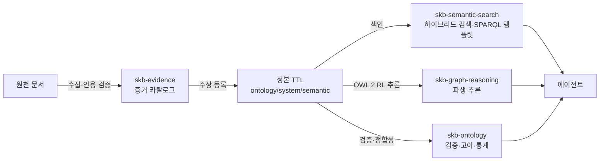

# SKB — Semantic Knowledge Base (v1.8)

SKB는 에이전트가 읽고 쓸 수 있는 **지식 베이스 스킬 팩**이다. 온톨로지 도메인 데이터의 정본은 TTL만 쓴다. 용어, 관계, 인스턴스, 공리, 레지스트리 소속, 출처는 모두 `ontology/system/semantic/**/*.ttl`에 둔다.

> README에는 **현재 마이너 버전의 운영 의미**만 남긴다. 패치와 이전 버전의 상세 변경은 [docs/changelog.md](docs/changelog.md)에 있다.

## 현재 버전 업데이트

### v1.8 (2026-10-09) — 저장소 루트를 줄이고, `skb init`을 스킬 하나만으로 실행

**1. 저장소 루트에는 지식 베이스 인스턴스가 없다.**
루트는 `docs/`, `skills/`, `tests/`, `.github/`, `install.sh`, `requirements.txt`, `README.md`, `LICENSE`만 가진다. 루트의 `agent-context/`, `archive/`, `record-archive/`, `canonical_root_hub.yaml`은 제거됐다. 이 파일들은 `skb init`이 대상 저장소에 만든다.

**2. 템플릿은 스킬 안으로 옮겼다.**
`skills/skb-repository-setup/assets/templates/`에 있다. `skb init`은 저장소 루트에 의존하지 않으므로, `skb-repository-setup`만 설치해도 동작한다.

**업그레이드**: 루트의 `agent-context/`, `record-archive/`, `canonical_root_hub.yaml`을 직접 읽던 도구는 `skb init`이 만든 대상 저장소를 기준으로 바꿔야 한다. 스킬 CLI와 계약은 바뀌지 않았다.

**3. 스킬 단위 변경 (v1.8 이후 승격분)**
- `skb-semantic-search` **v0.4.0**: TBox(클래스·속성) 색인, 벡터와 키워드 하이브리드 검색, 정확 일치 우선 순위, `expand`(domain·range·상하위 확장), 자주 묻는 SPARQL 템플릿(`sparql-search`, `sparql-run`), `eval` 평가 명령. 상세는 [changelog](docs/changelog.md)의 Unreleased 항목에 있다.

### 이전 마이너 버전

| 버전 | 날짜 | 한 줄 요약 |
|---|---|---|
| v1.7 | 2026-10-09 | `identity propose`에 발행 주체 후보 추가, `source-agents` 팩에 발행 주체 분류 추가 |

각 버전의 변경 내용, 업그레이드 방법, 알려진 한계는 [docs/changelog.md](docs/changelog.md)에 있다.

## 핵심 원칙

### TTL이 정본이다

YAML과 JSONL은 온톨로지 용어를 정의하지 않는다. 이 둘은 워크플로우 편집 층, 증거 카탈로그, 기록 저장에만 쓴다. 옛 온톨로지 컴파일러는 비공개 개발 저장소의 이력으로 남고, 공개 TTL 전용 배포에는 들어 있지 않다.

### 저장소는 데이터를 갖지 않는다

이 저장소는 지식 베이스 데이터를 담지 않는다. `skb init`이 대상 저장소에 지식 베이스 트리를 만들고, 스킬은 그 트리의 `layout:` 선언(없으면 legacy 경로)을 읽어 파일 위치를 정한다.

### 주장과 해석을 나눈다

문서는 저자의 **주장**이지 사실이 아니다. 처리 단계(`prov:Activity`)를 거칠수록 물리 세계에서 멀어진다. 그래서 문서가 **선언한 것**(관찰)과 우리가 **결론 내린 것**(해석)을 나눠 보관하고, 신뢰는 저장하지 않고 질의로 계산한다. 자세한 근거는 [provenance stance 가이드](docs/guides/provenance-stance.md)에 있다.

## 문제와 해법

| 문제 | SKB의 답 | 핵심 스킬 |
|---|---|---|
| 용어가 흩어지고 정의가 겹친다 | TTL 정본, SKOS 용어 레지스트리, 라벨 충돌 검사 | `skb-ontology` |
| 출처를 믿기 어렵다 | 증거 카탈로그, 원문 적재, 인용 검증, 주체 식별 검토 | `skb-evidence` |
| 추론 결과를 검증하기 어렵다 | OWL 2 RL 파생 추론(`*.inferred.ttl`), 일관성 검사 | `skb-graph-reasoning` |
| 필요한 용어를 찾기 어렵다 | 벡터와 키워드 하이브리드 검색, TBox 확장, SPARQL 템플릿 | `skb-semantic-search` |
| 운영 기록이 온톨로지에 섞인다 | 운영 기록은 `record-archive/`에 분리 | `skb-record-archive`, `skb-explain` |
| 런타임을 측정하기 어렵다 | L0~L3 측정 계층, 실행 맥락 슬롯 | `skb-harness` |
| 의도를 워크플로우로 옮길 때 승인 지점이 없다 | 의도 라우팅, 정책 판정, 사람 승인(HITL) 게이트 | `skb-orchestration` |



## 스킬

| 스킬 | 버전 | 역할 |
|---|---|---|
| `skb-orchestration` | 1.0.1 | 의도 라우팅, 거버넌스, 사람 승인 게이트 |
| `skb-repository-setup` | 1.2.1 | TTL 전용 지식 베이스 구조 부트스트랩 (`--layout b1\|legacy`) |
| `skb-evidence` | 1.2.6 | 원천 수집, 변환, 중복 제거, 증거 카탈로그, 인용 검증, 주체 식별 검토 |
| `skb-ontology` | 1.5.0 | Turtle 그래프의 추가, 조회, 검증, 고아 개체와 통계 |
| `skb-graph-reasoning` | 0.2.0 | OWL 2 RL 추론, 일관성 검사, 폐포 위의 SPARQL |
| `skb-semantic-search` | 0.4.0 | SKOS 개념, TBox 클래스·속성, 증거 청크의 의미 검색과 SPARQL 템플릿 |
| `skb-record-archive` | 1.0.0 | 온톨로지 밖의 운영 기록 관리 (SQLite, 이벤트, 스냅샷) |
| `skb-explain` | 1.1.0 | 기록과 온톨로지 의미를 사람이 읽는 Markdown으로 투영 |
| `skb-harness` | 1.1.1 | 런타임 측정과 검증 계층 (L0~L3) |

## 설치

```bash
git clone https://github.com/WMJOON/semantic-knowledge-base.git
cd semantic-knowledge-base
python3 -m pip install -r requirements.txt
./install.sh --codex        # 또는 --antigravity, --all (Claude Code + Codex + Antigravity)
```

설치 스크립트는 스킬 심볼릭 링크만 만들고, 지식 베이스 데이터는 복사하지 않는다.

## 빠른 시작

```bash
# 1. 새 도메인 부트스트랩 (유효한 TTL 그래프 생성)
skills/skb-repository-setup/scripts/skb init --target ./my-kb --domain prompt-token --apply --yes

# 2. 개념 추가 (IRI, 라벨, 출처를 함께 적는다)
skills/skb-ontology/scripts/skb-ontology add --target ./my-kb --domain prompt-token --kind concept \
  --iri https://example.org/prompt#emotional --label "감성적" \
  --evidence https://example.org/source/1 --apply

# 3. 검증: 레지스트리, 이름 규칙, 중복, 링크, 출처, SHACL
skills/skb-ontology/scripts/skb-ontology validate --target ./my-kb --domain prompt-token

# 4. 고아 개체와 통계
skills/skb-ontology/scripts/skb-ontology orphans --target ./my-kb --domain prompt-token
skills/skb-ontology/scripts/skb-ontology stats --target ./my-kb --domain prompt-token

# 5. OWL 2 RL 일관성 검사
skills/skb-graph-reasoning/scripts/skb-graph-reasoning check --target ./my-kb
```

### 의미 검색 (skb-semantic-search)

벡터 검색에는 zvec과 임베딩 모델이 필요하다. 3.11 이상 가상환경에서 `SKB_SEARCH_PYTHON`과 `SKB_RDF_PYTHON`을 그 인터프리터로 지정한다. 벡터 없이 키워드만 쓸 때는 `--mode keyword`를 준다.

```bash
S=skills/skb-semantic-search/scripts/skb-semantic-search
$S index tbox --target ./my-kb                      # TBox(클래스·속성) 색인
$S index concepts --target ./my-kb                  # SKOS 개념 색인
$S search tbox "구매를 대신 해 주는 사업" --target ./my-kb -k 5
$S expand "구매를 대신 해 주는 사업" --target ./my-kb --max-add 5   # domain·range·상하위 이웃 포함
$S sparql-search "하위 클래스가 뭐야"                # 자주 묻는 SPARQL 템플릿 찾기
$S sparql-run --template subclasses-of --bind "CLASS=q:크로스보더 커머스" --target ./my-kb
$S eval --target ./my-kb --gold skills/skb-semantic-search/references/eval-natural-gold.jsonl
```

`q:` 바인딩은 질의 텍스트를 TBox IRI로 바꾼다. 색인이 있으면 하이브리드로, 없으면 키워드로 해석한다. IRI를 직접 넣으면 그대로 쓴다.

자세한 내용은 [온톨로지 설정](docs/guides/ontology-config.md), [KB 디렉토리 구조](docs/kb-directory-structure.md), [에이전트 소비 계약](docs/contracts/agent-consumption-contract.md)을 본다.

## 검증

```bash
python3 -m pytest -q skills/skb-ontology/tests/test_ttl_only.py
python3 -m pytest -q skills/skb-repository-setup/tests/test_ttl_scaffold.py
python3 -m pytest -q skills/skb-ontology/tests/test_ttl_report.py
python3 -m pytest -q skills/skb-graph-reasoning/tests skills/skb-harness/tests
python3 -m pytest -q skills/skb-semantic-search/tests
bash .github/scripts/public_release_audit.sh        # 개인 경로, 이메일, 자격 증명 패턴 점검 (ripgrep 필요)
```

## 보안과 개인정보

자격 증명, 비공개 증거, 런타임 데이터베이스, work-memory 기록, 특정 기기의 절대 경로를 커밋하지 않는다. 공개 릴리스는 비공개 통합 저장소에서 정제한 스냅샷으로 만들며, 깨끗한 Git 이력으로 시작한다.

## 문서

- [변경 이력](docs/changelog.md) · [스킬 목록](docs/skills.md) · [문서 색인](docs/index.md)
- [KB 디렉토리 구조](docs/kb-directory-structure.md) · [온톨로지 설정](docs/guides/ontology-config.md)
- [provenance stance 가이드](docs/guides/provenance-stance.md) · [에이전트 소비 계약](docs/contracts/agent-consumption-contract.md)

## 라이선스

[MIT](LICENSE)
